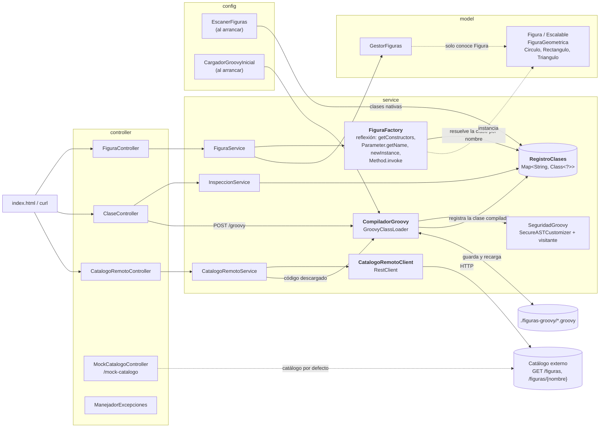

# Figuras geométricas: reflexión y Groovy en tiempo de ejecución

Actividad de Diseño y Arquitectura de Software (UDLA, ISWZ2202). Aplicación Java con Spring Boot que:

1. **instancia figuras geométricas por reflexión**, a partir del nombre de la clase y un mapa de parámetros, sin un `switch` por tipo;
2. **carga figuras nuevas compilando código Groovy mientras la aplicación está en marcha**, y las trata exactamente igual que las nativas;
3. **descarga figuras desde un servicio externo** (catálogo) y las registra del mismo modo.

El diseño de clases (`Figura`, `Escalable`, `FiguraGeometrica`, `Circulo`, `Rectangulo`, `Triangulo`, `GestorFiguras`) sigue el diagrama aprobado: [docs/figuras_geometricas.drawio](docs/figuras_geometricas.drawio).

## Cómo ejecutar

Hace falta **Java 17 o superior**. No hay que instalar Maven: el proyecto trae el Maven Wrapper (la primera vez descarga Maven y las dependencias).

```bash
# Linux, macOS, Git Bash
./mvnw spring-boot:run

# Windows (cmd o PowerShell)
.\mvnw.cmd spring-boot:run
```

La aplicación queda en <http://localhost:8080>. La página de demostración está en la raíz (`/`).

```bash
./mvnw test                 # ejecuta los tests
./mvnw package              # genera target/figuras-1.0.0.jar
java -jar target/figuras-1.0.0.jar
```

> **Sobre el JDK.** Está probado con JDK 27 (compilando con `--release 17`). Con ese JDK hace falta Groovy ≥ 4.0.33: las versiones anteriores (4.0.27) fallan al compilar cualquier script que mencione una clase del JDK (`Math`, `System`...) con `Unsupported class file major version 71`, porque el ASM interno de Groovy no entiende los `.class` del JDK. El `pom.xml` ya fija 4.0.33.

## Endpoints

| Método | Ruta | Descripción | Respuestas |
|---|---|---|---|
| `POST` | `/api/figuras` | Crea una figura: `{"clase":"Circulo","parametros":{"radio":5}}` | 201, 400, 404 |
| `GET` | `/api/figuras` | Lista las figuras con su área y perímetro | 200 |
| `GET` | `/api/figuras/{id}` | Una figura | 200, 400, 404 |
| `POST` | `/api/figuras/{id}/escalar` | `{"factor":2}` | 200, 400, 404 |
| `DELETE` | `/api/figuras/{id}` | Elimina la figura | 204, 404 |
| `GET` | `/api/figuras/area-total` | Suma de áreas de todas las figuras | 200 |
| `GET` | `/api/clases` | Clases disponibles y su origen (`NATIVA`, `GROOVY`, `REMOTA`) | 200 |
| `GET` | `/api/clases/{nombre}/inspeccion` | Constructores, campos y métodos (por reflexión) | 200, 404 |
| `POST` | `/api/clases/groovy` | Cuerpo: código Groovy en texto plano. Compila y registra | 201, 422 |
| `GET` | `/api/clases/remotas` | Figuras que ofrece el catálogo externo | 200, 502 |
| `POST` | `/api/clases/remotas/{nombre}` | Descarga la figura del catálogo, la compila y la registra | 201, 404, 422, 502 |
| `GET` | `/mock-catalogo/figuras[/{nombre}]` | Catálogo simulado (ver más abajo) | 200, 404 |

**Errores.** Todos tienen el mismo formato JSON `{timestamp, status, error, mensaje, ruta}`:

| Código | Cuándo |
|---|---|
| 400 | Parámetro faltante, sobrante o de tipo incorrecto; medida negativa; triángulo inválido; factor inválido; figura no escalable; JSON mal formado; id no numérico |
| 404 | Clase no registrada, figura inexistente, o figura que el catálogo no tiene |
| 422 | Código Groovy que no compila, rechazado por seguridad, o que no define una figura válida |
| 502 | El catálogo externo no responde, tarda demasiado, devuelve error 5xx o un formato inesperado |

## Ejemplos con `curl`

Los ejemplos usan sintaxis de Bash (Linux, macOS, Git Bash). En **PowerShell** use `curl.exe` (no el alias `curl`) y escape las comillas dobles del JSON: `-d '{\"clase\":\"Circulo\",\"parametros\":{\"radio\":5}}'`; o guarde el JSON en un archivo y use `-d "@figura.json"`. Las salidas están recortadas a lo esencial.

```bash
# Crear figuras
curl -X POST localhost:8080/api/figuras -H 'Content-Type: application/json' \
     -d '{"clase":"Circulo","parametros":{"radio":5}}'
# {"id":1,"clase":"Circulo","nombre":"Circulo","parametros":{"radio":5},"escala":1.0,
#  "area":78.53981633974483,"perimetro":31.41592653589793}

curl -X POST localhost:8080/api/figuras -H 'Content-Type: application/json' \
     -d '{"clase":"Rectangulo","parametros":{"base":4,"altura":3}}'
curl -X POST localhost:8080/api/figuras -H 'Content-Type: application/json' \
     -d '{"clase":"Triangulo","parametros":{"ladoA":3,"ladoB":4,"ladoC":5}}'      # área 6.0

# Consultar
curl localhost:8080/api/figuras
curl localhost:8080/api/figuras/1
curl localhost:8080/api/figuras/area-total
# {"areaTotal":..., "cantidad":3}

# Escalar y eliminar
curl -X POST localhost:8080/api/figuras/1/escalar -H 'Content-Type: application/json' -d '{"factor":2}'
# "escala":2.0, "area":314.159..., y "parametros" conserva los de creación (radio 5)
curl -X DELETE localhost:8080/api/figuras/1                                        # 204

# Errores
curl -X POST localhost:8080/api/figuras -H 'Content-Type: application/json' \
     -d '{"clase":"Circulo","parametros":{"radio":-3}}'                            # 400
curl -X POST localhost:8080/api/figuras -H 'Content-Type: application/json' \
     -d '{"clase":"Triangulo","parametros":{"ladoA":1,"ladoB":2,"ladoC":10}}'      # 400
curl -X POST localhost:8080/api/figuras -H 'Content-Type: application/json' \
     -d '{"clase":"Circulo","parametros":{"radio":"mucho"}}'                       # 400
curl -X POST localhost:8080/api/figuras -H 'Content-Type: application/json' \
     -d '{"clase":"Rectangulo","parametros":{"base":4}}'                           # 400: falta altura

# Inspección por reflexión
curl localhost:8080/api/clases
curl localhost:8080/api/clases/Triangulo/inspeccion
```

### Flujo Pentagono: una clase que no existe y se crea en vivo

```bash
# 1. Todavía no existe: 404
curl -X POST localhost:8080/api/figuras -H 'Content-Type: application/json' \
     -d '{"clase":"Pentagono","parametros":{"lado":2}}'
# {"status":404,"mensaje":"La clase 'Pentagono' no está registrada. Clases disponibles: [Circulo, Rectangulo, Triangulo]", ...}

# 2. Se registra enviando su código fuente Groovy (texto plano)
curl -X POST localhost:8080/api/clases/groovy -H 'Content-Type: text/plain' \
     --data-binary @src/main/resources/ejemplos/Pentagono.groovy
# {"nombre":"Pentagono","nombreCompleto":"Pentagono","origen":"GROOVY"}

# 3. Ahora se crea igual que una nativa
curl -X POST localhost:8080/api/figuras -H 'Content-Type: application/json' \
     -d '{"clase":"Pentagono","parametros":{"lado":2}}'
# {"id":2,"clase":"Pentagono","nombre":"Pentagono","parametros":{"lado":2},"escala":1.0,
#  "area":6.881909602355868,"perimetro":10.0}

# 4. El código malicioso se rechaza (System.exit en el constructor)
curl -X POST localhost:8080/api/clases/groovy -H 'Content-Type: text/plain' \
     --data-binary @src/main/resources/ejemplos/Malicioso.groovy
# 422 {"mensaje":"No se pudo compilar el código Groovy: No se permite llamar al método (sobre java.lang.System): 'exit' ..."}
```

La clase se guarda en `./figuras-groovy/Pentagono.groovy` y se recarga al reiniciar la aplicación.

### Catálogo externo

```bash
curl localhost:8080/api/clases/remotas                      # ["Hexagono","Pentagono"]
curl -X POST localhost:8080/api/clases/remotas/Hexagono     # {"nombre":"Hexagono",...,"origen":"REMOTA"}
curl -X POST localhost:8080/api/figuras -H 'Content-Type: application/json' \
     -d '{"clase":"Hexagono","parametros":{"lado":2}}'
curl -X POST localhost:8080/api/clases/remotas/Dodecaedro   # 404: el catálogo no la tiene
```

El guion para presentar todo esto en clase está en [docs/guion-demo.md](docs/guion-demo.md).

## Arquitectura



Estructura de paquetes (`com.udla.figuras`):

| Paquete | Contenido |
|---|---|
| `model` | Las figuras y `GestorFiguras`. Sin dependencias de Spring. |
| `service` | `FiguraFactory`, `RegistroClases`, `CompiladorGroovy`, `SeguridadGroovy`, `CatalogoRemotoClient`, `CatalogoRemotoService`, `InspeccionService`, `FiguraService` y `service.excepcion` |
| `controller` | Controladores REST, catálogo simulado y `ManejadorExcepciones` |
| `dto` | Records de petición y respuesta |
| `config` | `FigurasConfig` (beans), `EscanerFiguras` (escaneo del classpath), `CargadorGroovyInicial` |

## Dónde se usa reflexión y por qué

La actividad exige que ningún sitio conozca los tipos concretos de figura. La reflexión es lo que lo permite:

- **Descubrir las clases nativas** (`EscanerFiguras`): `ClassPathScanningCandidateComponentProvider` escanea el paquete `model` y registra toda clase concreta que implemente `Figura`. Añadir una figura nativa no obliga a tocar ninguna lista.
- **Crear la figura** (`FiguraFactory.crear`): busca la clase en `RegistroClases` por nombre simple, elige un constructor con `Class.getConstructors()`, empareja los parámetros recibidos con los del constructor **por nombre** (`Parameter.getName()`), convierte los tipos y llama a `Constructor.newInstance`. Para que `getName()` devuelva `radio` y no `arg0`, el código se compila con `-parameters` (en `maven-compiler-plugin` y con `CompilerConfiguration.setParameters(true)` para Groovy).
- **Calcular área y perímetro** (`FiguraFactory.calcularArea/Perimetro`): se invocan con `Method.invoke`, de modo que el mismo mecanismo sirve para cualquier clase cargada, sea nativa o dinámica.
- **Inspeccionar una clase** (`InspeccionService`): constructores, campos y métodos con `Class`, `Constructor`, `Field` y `Method`. La página de demostración usa esta información para generar el formulario de cada clase.
- **Cargar clases nuevas** (`CompiladorGroovy`): `GroovyClassLoader.parseClass` produce un `Class<?>` en tiempo de ejecución; desde ahí todo lo anterior le sirve igual.
- **Errores**: cuando el constructor lanza una excepción, `Constructor.newInstance` la envuelve en `InvocationTargetException`; la fábrica la desempaqueta para mostrar la causa real («La medida 'radio' debe ser un número mayor que 0»).

`GestorFiguras`, en cambio, **no usa reflexión ni `instanceof`**: solo conoce la interfaz `Figura`. Es el polimorfismo del diagrama.

## Seguridad del código dinámico

> **Riesgo.** Compilar y cargar código que llega por la red es **ejecución remota de código**. Un script podría llamar a `System.exit(0)`, leer o borrar archivos, lanzar procesos, abrir conexiones o usar reflexión para saltarse cualquier otro control. Esto es verdad tanto para `POST /api/clases/groovy` como para el código descargado del catálogo: **el código remoto no es más confiable que el que envía un usuario**, y pasa exactamente por la misma política.

**Mitigación.** Todo se comprueba **en tiempo de compilación**: el código rechazado nunca llega a cargarse ni se guarda en disco (`SeguridadGroovy`).

1. **Lista blanca de imports** con `SecureASTCustomizer`: solo `java.lang.Math`, tipos básicos de `java.lang`, `BigDecimal`, colecciones sencillas, `groovy.transform.*` y el paquete `com.udla.figuras.model` (donde viven `Figura` y `FiguraGeometrica`). Se permite el paquete `model` y no todo `com.udla.figuras` para que un script no pueda tocar `service` ni `controller`.
2. **Visitante propio del AST** que aplica esa misma lista blanca a *todo tipo usado* (también los que Groovy importa por defecto, como `System` o `File`, y los nombres totalmente cualificados) y prohíbe llamadas de reflexión y evaluación (`getClass`, `forName`, `invokeMethod`, `execute`, `evaluate`...), el acceso por `.@campo`, los nombres de método calculados en ejecución y las referencias `obj["class"]`. Existe porque **`SecureASTCustomizer` por sí solo solo recorre los métodos**: no mira constructores, inicializadores estáticos ni inicializadores de campo, y ahí un `System.exit(0)` pasaba sin ser visto.
3. **Anotaciones**: solo una lista corta de `groovy.transform` y sin alias en los imports. `@ASTTest` y `@Grab` ejecutan código o descargan JARs *durante la compilación*; `@Grab` se descarta además mirando el texto fuente, porque su transformación se ejecuta antes que cualquier comprobación del AST.
4. Tamaño máximo del código (50 000 caracteres); una clase dinámica no puede reemplazar a una nativa.

**Límites: esto no es un sandbox.**

- Groovy es dinámico: las llamadas sobre objetos sin tipo se vigilan por *nombre* de método, y puede haber formas de ocultarlas que la lista no cubra.
- No se limita CPU ni memoria: un `while (true) {}` dentro de `calcularArea` bloquea un hilo para siempre.
- Cada compilación crea su propio *classloader* para poder redefinir una clase. Los anteriores se liberan solo cuando ya no queda ninguna figura creada con la versión vieja.

Para exponer esto a usuarios no confiables habría que ejecutar el código en otro proceso o contenedor sin permisos. En este proyecto se mitiga lo evidente y se deja constancia del resto. **No lo publique en Internet tal cual.**

Los tests (`CompiladorGroovyTest`) incluyen unos 40 scripts hostiles distintos (más algunos de código inválido), y 16 de ellos comprueban además el motivo exacto del rechazo, para que ninguno pase «por casualidad».

## Catálogo externo

### Contrato

| Petición | Respuesta |
|---|---|
| `GET {url}/figuras` | Lista JSON de nombres: `["Pentagono","Hexagono"]` |
| `GET {url}/figuras/{nombre}` | `{"nombre":"Pentagono","codigoGroovy":"import ...\nclass Pentagono ..."}` |

El cliente (`CatalogoRemotoClient`) usa `RestClient` con *timeout* de conexión y de lectura. Cada fallo se traduce a un mensaje claro y la aplicación sigue funcionando: servicio caído (`No se pudo conectar...`), tiempo de espera agotado, error HTTP, respuesta que no es JSON, falta `codigoGroovy`, figura inexistente (404), o código que no compila (422). Además exige que la clase del código descargado se llame como la figura pedida.

El cliente lee la respuesta como JSON **sin mirar el `Content-Type`** y tolera un BOM inicial, para que funcione con hosts estáticos que sirven JSON como `text/html` o `application/octet-stream`.

### Catálogo simulado (activado por defecto)

Como no existe un servicio público con este contrato, la propia aplicación sirve uno en `/mock-catalogo/...` con los ejemplos de `src/main/resources/ejemplos` (`Pentagono` y `Hexagono`). `Malicioso` está excluido a propósito: es un caso de prueba de seguridad, no una figura para «traer del catálogo». Por defecto:

```properties
figuras.catalogo.url=http://localhost:8080/mock-catalogo
```

> Si cambia `server.port`, cambie también el puerto de esa URL.

### Apuntarlo a un servicio real

```bash
java -jar target/figuras-1.0.0.jar \
     --figuras.catalogo.url=https://mi-servicio.example.com \
     --figuras.catalogo.mock.enabled=false
```

(o las mismas propiedades en `application.properties`). Opciones:

- **Un servicio propio** que cumpla el contrato anterior (cualquier lenguaje o framework).
- **Un host de archivos estáticos.** Basta con dos archivos, porque el cliente no exige el `Content-Type`:
  ```text
  figuras/index.html     →  ["Pentagono"]
  figuras/Pentagono      →  {"nombre":"Pentagono","codigoGroovy":"..."}      (JSON en una sola línea, con \n escapados)
  ```
  **Probado** con `jwebserver` (viene con el JDK): `jwebserver -d catalogo -p 9000` y `--figuras.catalogo.url=http://127.0.0.1:9000`, con el índice con BOM, la figura sin extensión y el mock desactivado.
  **En GitHub Pages** la mecánica es la misma (publicar `figuras/index.html` y `figuras/Pentagono.html`; Pages sirve `/figuras/Pentagono` desde el `.html` y redirige `/figuras` a `/figuras/`), pero **no lo he probado contra GitHub**, solo contra `jwebserver`.
- Un *gist* o un único JSON en `raw.githubusercontent.com` **no sirve tal cual**: el contrato necesita dos rutas distintas (`/figuras` y `/figuras/{nombre}`).

## Configuración

| Propiedad | Por defecto | Descripción |
|---|---|---|
| `figuras.paquete-nativas` | `com.udla.figuras.model` | Paquete que se escanea al arrancar. Solo debe contener figuras reales: **toda** clase concreta que implemente `Figura` se registra. |
| `figuras.groovy.dir` | `./figuras-groovy` | Carpeta de persistencia de los `.groovy` aceptados |
| `figuras.catalogo.url` | `http://localhost:8080/mock-catalogo` | URL base del catálogo externo |
| `figuras.catalogo.timeout-ms` | `3000` | Tiempo de espera de conexión y de lectura |
| `figuras.catalogo.mock.enabled` | `true` | Activa `/mock-catalogo` |
| `figuras.catalogo.mock.excluidos` | `Malicioso` | Ejemplos que el catálogo simulado no ofrece |

## Diferencias respecto al diagrama de clases

El diagrama de [docs/figuras_geometricas.drawio](docs/figuras_geometricas.drawio) es una copia del aprobado con estos añadidos:

- `GestorFiguras.eliminar(f)` y `getFiguras()`: hacen falta para borrar por id desde la API. El gestor sigue sin usar `instanceof`.
- Las figuras no reciben color en el constructor (`Circulo(radio)`, como en el diagrama): todas usan «Sin color» por defecto.
- `FiguraGeometrica` tiene dos ayudas protegidas, `exigirPositivo` y `exigirFactor`, que también rechazan `NaN` e infinito.
- Los ids y los parámetros de creación **no** están en el modelo: los guarda `FiguraService`, para no contaminar el diseño de las figuras.

## Notas de comportamiento

- **`parametros` y `escala`.** `parametros` devuelve siempre los valores *de creación*; el campo `escala` es el producto de los factores aplicados. No se reescriben los parámetros porque, para una clase cualquiera, no se sabe cuáles son longitudes.
- **`escalar` y figuras Groovy.** `Escalable` es una interfaz aparte de `Figura`: una figura Groovy que solo implemente `Figura` se crea bien, pero `escalar` responde 400.
- **Conversión de tipos.** `5` o `"5"` valen para un `double`; un decimal para un parámetro entero, una lista o un objeto JSON se rechazan (Spring, por sí solo, convertiría `[1, 2]` en `1` sin avisar).
- **Valores enormes.** Si el área o el perímetro no son finitos, la creación se rechaza con 400.
- **Estado en memoria.** Las figuras creadas viven en memoria y se pierden al reiniciar. Solo se persisten las clases Groovy.

## Tests

`./mvnw test` ejecuta 163 tests (JUnit 5, Spring Boot Test, MockMvc). Cubren los 8 casos de la actividad:

| # | Caso | Dónde |
|---|---|---|
| 1 | `("Circulo", radio=5)`: área ≈ 78.54, perímetro ≈ 31.42 | `FiguraFactoryTest`, `FiguraControllerTest` |
| 2 | Rectángulo y Triángulo (3,4,5 → área 6) | `FiguraFactoryTest`, `FiguraControllerTest` |
| 3 | Parámetro faltante, tipo incorrecto, medida negativa, triángulo inválido | `FiguraFactoryTest`, `FiguraControllerTest` |
| 4 | Clase inexistente | `FiguraFactoryTest`, `FiguraControllerTest` |
| 5 | Registrar `Pentagono.groovy` y crearlo con `FiguraFactory` como si fuera nativo | `CompiladorGroovyTest`, `ClaseGroovyControllerTest` |
| 6 | Rechazo del script malicioso | `CompiladorGroovyTest` (y ~40 scripts hostiles más), `ClaseGroovyControllerTest` |
| 7 | Catálogo simulado: descargar, compilar y usar | `CatalogoRemotoControllerTest` (HTTP real), `CatalogoRemotoServiceTest` |
| 8 | `GestorFiguras.areaTotal()` con figuras nativas y dinámicas mezcladas | `GestorFigurasTest`, `CompiladorGroovyTest`, `FiguraControllerTest` |

Además: fallos del servicio externo con un servidor HTTP falso (`CatalogoRemotoClientTest`: 404, 500, *timeout*, servicio caído, JSON roto, BOM, redirecciones...), persistencia y recarga de clases Groovy, y la API completa.

## Limitaciones conocidas

- El código Groovy no está en un *sandbox*; véase la sección de seguridad.
- Las figuras creadas no se persisten.
- Concurrencia: `FiguraService` serializa sus operaciones con `synchronized`; es suficiente para una demo, no para carga real.
- La URL por defecto del catálogo simulado fija el puerto 8080.
- La página de demostración (`/`) no tiene autenticación, como el resto de la API.
